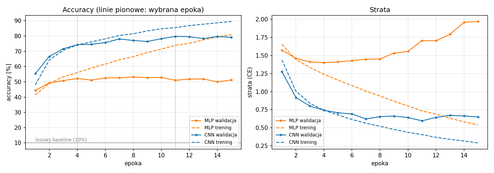
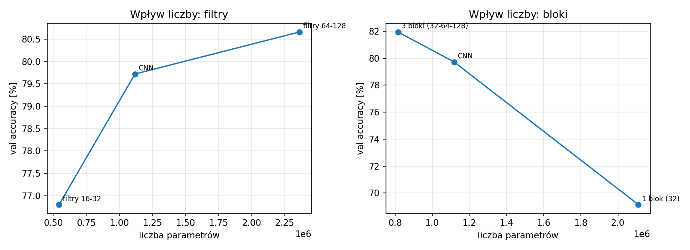
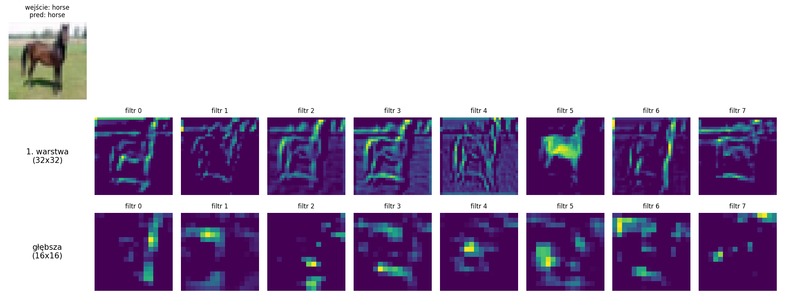

# Sprawozdanie laboratoryjne

**Przedmiot:** Uczenie głębokie do rozpoznawania obiektów
**Zajęcia nr 4 / temat:** CNN — splotowe sieci dla obrazów
**Autor / grupa:** Michał [UZUPEŁNIJ: nazwisko] / [UZUPEŁNIJ: grupa]
**Data:** [UZUPEŁNIJ]

Kod: [`lab4_cnn_vs_mlp.ipynb`](lab4_cnn_vs_mlp.ipynb) | Wyniki: `figures/`, `results/`

---

## 1. Cel ćwiczenia

Zbudowanie prostej sieci splotowej (CNN) i porównanie jej z perceptronem wielowarstwowym (MLP) na tym samym zbiorze CIFAR-10 pod względem accuracy, liczby parametrów i czasu uczenia, oraz zbadanie, jak lokalność i współdzielenie wag wpływają na różnice. Zakres dodatkowy: wpływ liczby filtrów i liczby bloków splotowych oraz wizualizacja map cech.

## 2. Metoda i implementacja

### 2.1 Dane

CIFAR-10: 60 000 kolorowych obrazów 32×32 w 10 klasach. Zbiór treningowy (50 000) podzielono **raz** na **45 000 treningowych i 5 000 walidacyjnych** (stała permutacja, seed 42, indeksy zapisane w `results/split_idx.npz`); zbiór testowy (10 000) nie brał udziału w żadnych decyzjach. Przetwarzanie jest identyczne dla obu modeli: normalizacja kanałowa (średnia i odchylenie CIFAR-10), **bez augmentacji**. Wejście ma 3 kanały (MLP: 3·32·32 = 3072 wartości, CNN: `Conv2d(3, …)`).

### 2.2 Modele

| Model | Architektura | Parametry |
|---|---|---|
| MLP | `Flatten` (3072) → `Linear` 512 → `ReLU` → `Linear` 256 → `ReLU` → `Linear` 10 | 1 707 274 |
| CNN (baza) | 2 bloki [`Conv3×3` → `BatchNorm` → `ReLU`] × 2 → `MaxPool2` (kanały 32 i 64, 32×32 → 8×8), następnie `Flatten` (4096) → `Linear` 256 → `ReLU` → `Dropout(0,3)` → `Linear` 10 | 1 117 354 |

Rozkład parametrów: w MLP pierwsza warstwa gęsta ma 1 573 376 parametrów (92% modelu), w CNN część splotowa ma tylko ok. 66 tys. parametrów (6%), a pierwsza warstwa gęsta po spłaszczeniu 1 048 832 (94%).

### 2.3 Konfiguracja treningu i pomiaru

| Element | Wartość |
|---|---|
| Optymalizator | Adam, **lr = 1e-3** (oba modele) |
| Batch size | **128** |
| Budżet | **15 epok** (oba modele) |
| Funkcja straty | Cross-Entropy |
| Seed | 0 (inicjalizacja i kolejność batchy) |
| Wybór epoki | **najniższa strata walidacyjna** (checkpoint z tej epoki) |
| Sprzęt pomiaru czasu | [UZUPEŁNIJ z `results/run_config.json`, np. NVIDIA Tesla T4, Google Colab], PyTorch [UZUPEŁNIJ] |
| Pomiar czasu | tylko pętla treningowa (bez ewaluacji), z synchronizacją GPU; dane w pamięci GPU, więc czas odzwierciedla obliczenia, a nie ładowanie danych |

**Uczciwość porównania:** te same dane i podział, to samo przetwarzanie, ten sam optymalizator, lr, batch i liczba epok oraz ta sama funkcja treningowa. Zbiór testowy użyto **jednokrotnie**, po wyborze checkpointów na walidacji; nie służył do żadnych decyzji.

## 3. Wyniki

### 3.1 Porównanie MLP i CNN

| Model | Parametry | Wybrana epoka | Accuracy walidacyjna [%] | **Accuracy testowa [%]** (checkpoint) | Accuracy testowa [%] (ostatnia epoka) | Nad losowym (10%) [p.p.] | Czas uczenia (15 epok) [s] | Czas / epokę [s] |
|---|---|---|---|---|---|---|---|---|
| MLP | 1 707 274 | [UZUPEŁNIJ] | [UZUPEŁNIJ] | [UZUPEŁNIJ] | [UZUPEŁNIJ] | [UZUPEŁNIJ] | [UZUPEŁNIJ] | [UZUPEŁNIJ] |
| CNN | 1 117 354 | [UZUPEŁNIJ] | [UZUPEŁNIJ] | [UZUPEŁNIJ] | [UZUPEŁNIJ] | [UZUPEŁNIJ] | [UZUPEŁNIJ] | [UZUPEŁNIJ] |

*(źródło: `results/main_comparison.csv`)*

### 3.2 Krzywe uczenia

Linie ciągłe: walidacja, przerywane: trening (w trakcie epoki, tryb treningowy), pionowe linie: wybrana epoka. Szara linia poziomo to poziom losowy (10%).

### 3.3 Zakres dodatkowy: liczba filtrów i liczba bloków

| Eksperyment | Model | Parametry | Wybrana epoka | Accuracy walidacyjna [%] | Strata walidacyjna | Czas uczenia [s] |
|---|---|---|---|---|---|---|
| filtry | 16–32 | [UZUPEŁNIJ] | | | | |
| filtry | 32–64 (baza) | 1 117 354 | | | | |
| filtry | 64–128 | [UZUPEŁNIJ] | | | | |
| bloki | 1 blok (32) | [UZUPEŁNIJ] | | | | |
| bloki | 2 bloki (baza) | 1 117 354 | | | | |
| bloki | 3 bloki (32–64–128) | [UZUPEŁNIJ] | | | | |

*(źródło: `results/extras_filters_blocks.csv`; porównanie na walidacji, zbiór testowy nie był używany)*

### 3.4 Zakres dodatkowy: mapy cech

## 4. Analiza i interpretacja

*(uzupełnij po uruchomieniu, własnymi liczbami; wklej mi wyniki, a przygotuję szkic)*

- **Jakość względem baseline'u.** [UZUPEŁNIJ: czy CNN ma wyższą accuracy testową niż MLP i o ile p.p.; obie wartości wobec poziomu losowego 10%.] Jeśli CNN nie wygrała, opisz warunki i możliwe przyczyny (krótki trening, brak augmentacji, przeuczenie, wybór epoki), zamiast zakładać przewagę.
- **Lokalność i współdzielenie wag.** W CNN ten sam mały filtr 3×3 jest przesuwany po całym obrazie, więc (a) każdy neuron patrzy tylko na lokalne sąsiedztwo pikseli, a (b) wzorzec raz wyuczony (krawędź, kolor) działa w każdym miejscu obrazu. MLP po `Flatten` traktuje każdy piksel jako niezależną cechę i musi nauczyć się rozpoznawać ten sam wzorzec osobno w każdym położeniu. *Po chłopsku:* CNN uczy się „jednej lupy", którą przykłada wszędzie, a MLP uczy się osobnej lupy dla każdego miejsca. [UZUPEŁNIJ: jak to widać w wynikach.]
- **Liczba parametrów a koszt.** CNN ma o ok. 35% mniej parametrów (1,12 mln vs 1,71 mln), ale **94% z nich to pierwsza warstwa gęsta**, a sama część splotowa to ok. 66 tys. parametrów, co dobrze pokazuje, jak tanie jest współdzielenie wag. Mniej parametrów nie znaczy jednak szybciej: filtr jest stosowany w każdej pozycji obrazu, więc CNN wykonuje znacznie więcej obliczeń. [UZUPEŁNIJ: czas / epokę MLP vs CNN i komentarz.]
- **Przeuczenie i wybór epoki.** [UZUPEŁNIJ: czy któraś sieć przeucza się (trening rośnie, walidacja stoi, strata walidacyjna rośnie); w której epoce wybrano checkpoint.]
- **Filtry i bloki (dodatkowo).** [UZUPEŁNIJ: jak accuracy i liczba parametrów zmieniają się przy 16–32 / 32–64 / 64–128 filtrach.] Liczba parametrów nie rośnie monotonicznie z liczbą bloków: model z 1 blokiem ma 2,11 mln parametrów (większy niż MLP), bo po jednym poolingu spłaszcza 32×16×16 = 8192 wartości do warstwy gęstej, a model z 3 blokami ma 0,82 mln. [UZUPEŁNIJ: wpływ liczby bloków na wynik.]
- **Mapy cech (dodatkowo).** [UZUPEŁNIJ: pierwsza warstwa zwykle reaguje na proste wzorce (krawędzie, kolory, kontrast) i zachowuje rozmieszczenie przestrzenne obrazu; głębsza ma mniejszą rozdzielczość (16×16) i bardziej abstrakcyjne, mniej czytelne dla człowieka odpowiedzi. Opisz, co widać na wykresie.]
- **Ograniczenia.** Jeden seed i jeden przebieg pomiaru czasu (czas na współdzielonym GPU w Colabie może się wahać). Błąd standardowy accuracy na 10 000 obrazów testowych wynosi ok. 0,4–0,5 p.p., więc mniejsze różnice nie są wiarygodne. Budżet 15 epok, brak augmentacji i brak strojenia hiperparametrów. **Architektury różnią się nie tylko splotami:** CNN z ćwiczenia ma BatchNorm i dropout, a MLP nie, więc część różnicy może wynikać z regularyzacji, a nie wyłącznie ze struktury splotowej. Wyniki dotyczą CIFAR-10 i małych sieci.

## 5. Wnioski

*(uzupełnij liczbami)*
1. Accuracy testowa: MLP [UZUPEŁNIJ]%, CNN [UZUPEŁNIJ]% (poziom losowy: 10%); CNN [UZUPEŁNIJ: lepsza / gorsza] o [UZUPEŁNIJ] p.p.
2. Parametry: MLP 1 707 274, CNN 1 117 354 (o ok. 35% mniej); czas uczenia: MLP [UZUPEŁNIJ] s, CNN [UZUPEŁNIJ] s ([UZUPEŁNIJ: sprzęt]).
3. [UZUPEŁNIJ: wpływ lokalności i współdzielenia wag; wniosek o liczbie filtrów i bloków.]
4. Kierunki poprawy: augmentacja i dłuższy trening, strojenie hiperparametrów, kilka seedów, porównanie MLP z tą samą regularyzacją (BatchNorm, dropout), głębsze sieci splotowe.

*[OPCJONALNIE, jeśli prowadzący tego wymagają: Użycie narzędzi AI: do przygotowania szkieletu kodu i struktury sprawozdania wykorzystano asystenta AI (Claude, Anthropic); eksperymenty, analizę i wnioski wykonano samodzielnie.]*
