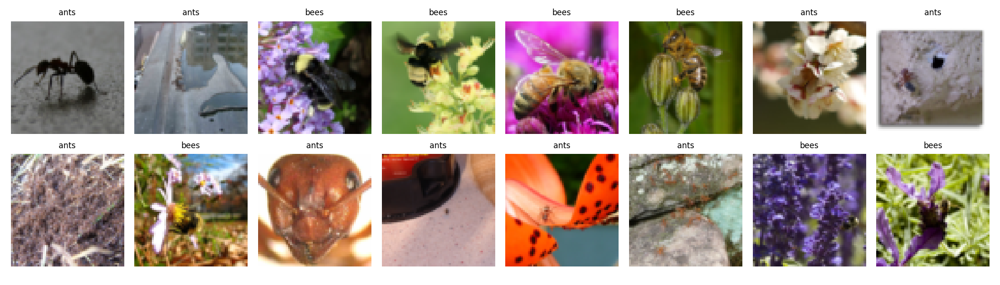
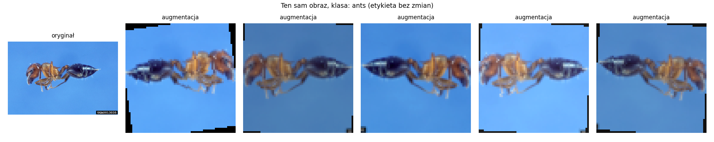
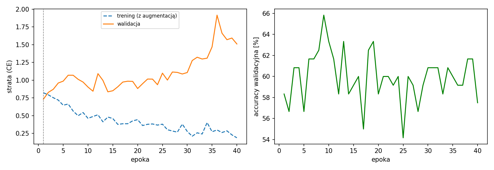
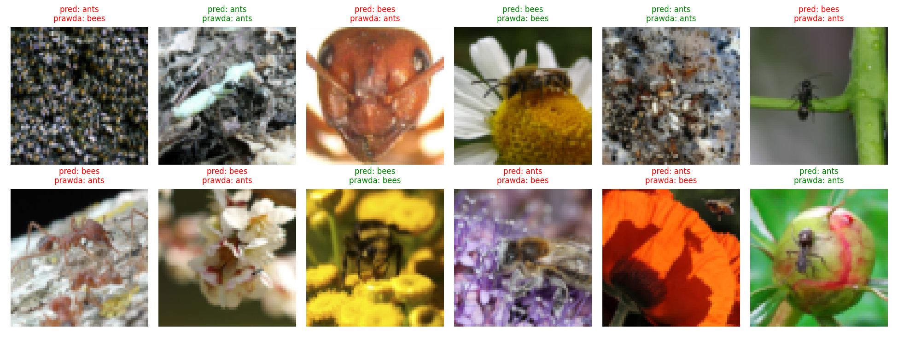
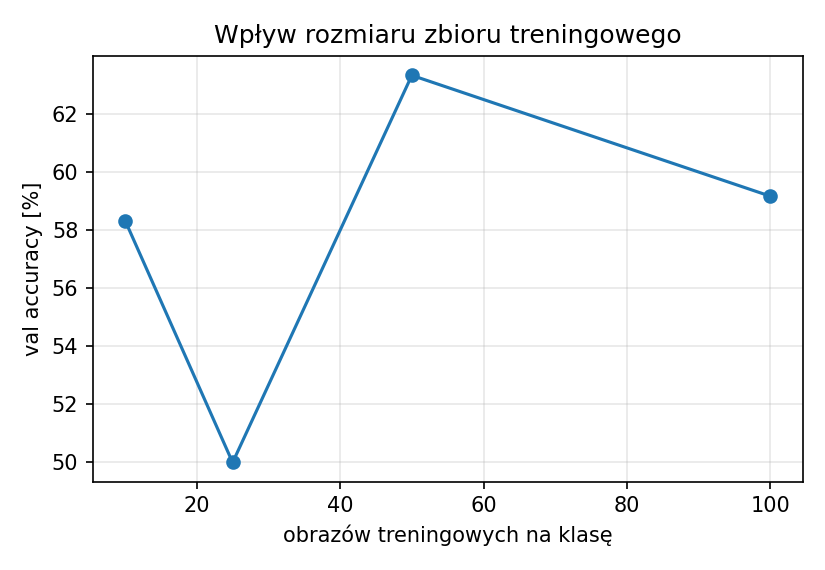

# Sprawozdanie laboratoryjne

**Przedmiot:** Uczenie głębokie do rozpoznawania obiektów
**Zajęcia nr 3 / temat:** Dane obrazowe i wideo: potok i własny zbiór
**Autor / grupa:** Michał Pakuła / GL0.3
**Data:** 28.10.2026

Kod: [`lab3_pipeline.ipynb`](lab3_pipeline.ipynb) | Dane i wyniki: `dataset/`, `figures/`, `results/`

---

## 1. Cel ćwiczenia

Przygotowanie mini-zbioru obrazów w układzie ImageFolder oraz kompletnego potoku danych (ImageFolder → transformacje → DataLoader): wariant ewaluacyjny i treningowy (z augmentacją), statystyki zbioru, kontrola paczki i podgląd augmentacji. Zakres dodatkowy: MLP wytrenowany na przygotowanym zbiorze oraz wpływ liczby obrazów treningowych na wynik.

## 2. Metoda i implementacja

### 2.1 Dane, źródło i warunki użycia

| Element | Opis |
|---|---|
| Zbiór źródłowy | *ants vs bees* (mrówki i pszczoły), mały podzbiór ImageNet udostępniony w tutorialu PyTorch ([hymenoptera_data.zip](https://download.pytorch.org/tutorial/hymenoptera_data.zip)); zgodnie z zaleceniem prowadzącego jako źródło danych |
| Mini-zbiór | zbudowany przeze mnie przez **losowe (seed 0), zbalansowane próbkowanie**: 100 obrazów treningowych i 60 walidacyjnych na klasę (z dostępnych 123 / 121 w treningu oraz 70 / 83 w walidacji) |
| Klasy | `ants`, `bees` |
| Układ | `dataset/train/<klasa>/`, `dataset/val/<klasa>/` (ImageFolder); lista wybranych plików z oryginalnymi ścieżkami i rozmiarami w `dataset/manifest.csv` |
| Podział | z oryginalnego zbioru: osobne fotografie do treningu i walidacji (to nie klatki wideo, więc nie ma przecieku sąsiednich, niemal identycznych klatek między podziałami) |
| Odtwarzalność | notebook pobiera dane i buduje identyczny mini-zbiór (seed 0) |

**Warunki użycia i RODO.** Obrazy pochodzą z ImageNet, którego warunki dostępu przewidują użycie niekomercyjne, badawcze i edukacyjne; wykorzystano je wyłącznie w celach dydaktycznych [SPRAWDŹ aktualne warunki ImageNet]. Dla samego pliku `hymenoptera_data.zip` nie znalazłem osobnej licencji, więc traktuję go na warunkach ImageNet. Na części zdjęć widoczne są oznaczenia źródła (kody na obrazie), co sugeruje, że prawa autorskie należą do ich autorów, dlatego zbiór służy tylko do ćwiczenia. Zbiór przedstawia zdjęcia owadów, a na przejrzanych przykładach nie widać osób ani innych danych osobowych, więc ryzyko związane z RODO (identyfikacja osób) nie występuje i nie stosowano anonimizacji.

**Zakres wideo.** Zbiór nie pochodzi z wideo, więc punkty dotyczące FPS, próbkowania klatek i konwersji BGR → RGB (OpenCV) nie mają zastosowania. Obrazy wczytuje PIL (ImageFolder), który zwraca je w kolejności RGB.

### 2.2 Potok transformacji

| Wariant | Transformacje |
|---|---|
| Ewaluacyjny (val) | `Resize(64)` (krótszy bok) → `CenterCrop(64)` → `ToTensor` → `Normalize(0,5; 0,5)` |
| Treningowy (train) | `Resize(64)` → `CenterCrop(64)` → `RandomHorizontalFlip` → `RandomRotation(±15°)` → `ColorJitter(jasność, kontrast 0,2)` → `ToTensor` → `Normalize(0,5; 0,5)` |

`Resize` + `CenterCrop` zachowuje proporcje obrazu, kosztem odcięcia brzegów. Augmentację zastosowano **tylko** w wariancie treningowym. Odbicie poziome zachowuje etykietę (mrówka i pszczoła pozostają tą samą klasą po odbiciu). Dane wczytano przez `ImageFolder` i `DataLoader` (batch 16, tasowanie tylko w treningu).

## 3. Wyniki

### 3.1 Statystyki zbioru

| Klasa | train | val | razem |
|---|---|---|---|
| ants | 100 | 60 | 160 |
| bees | 100 | 60 | 160 |
| **razem** | **200** | **120** | **320** |

- Liczba klas: **2**, `class_to_idx`: **{"ants": 0, "bees": 1}** (identyczne w train i val, sprawdzone w kodzie).
- Rozmiar po transformacji: **3×64×64** (`float32`), zakres wartości po normalizacji [-1, 1].
- Balans klas: idealny, train 100 / 100, val 60 / 60.
- Rozmiary oryginałów: szerokość od 193 do 2592 px (mediana 500), wysokość od 130 do 1984 px (mediana 375); wszystkie 320 obrazów w trybie RGB.

### 3.2 Kontrola paczki i augmentacja

Kształt paczki: **(16, 3, 64, 64)**, etykiety `[0, 0, 1, 1, 1, 1, 0, 0, 0, 1, 0, 0, 0, 0, 1, 1]` (w paczce są obie klasy, a podpisy `ants` / `bees` zgadzają się z mapowaniem `class_to_idx`).

### 3.3 MLP na przygotowanym zbiorze (dodatkowo)

Architektura: `Flatten` (12 288) → `Linear` 256 → `ReLU` → `Dropout(0,3)` → `Linear` 128 → `ReLU` → `Dropout(0,3)` → `Linear` 2; **3 179 138 parametrów**. Adam, lr = 1e-3, batch 16, 40 epok.

| Miara (zbiór walidacyjny, 120 obrazów) | Wartość |
|---|---|
| Accuracy po 40 epokach | **57,5%** |
| Strata walidacyjna po 40 epokach | 1,510 |
| Epoka z najniższą stratą walidacyjną | 1 (strata ok. 0,73), accuracy 58,3% |

### 3.4 Wpływ liczby obrazów treningowych (dodatkowo)

| Obrazów na klasę | Val accuracy po 40 epokach [%] | Val accuracy w epoce z min. stratą [%] | Min. strata walidacyjna |
|---|---|---|---|
| 10 | 58,33 | 54,17 | 1,172 |
| 25 | 50,00 | 49,17 | 1,034 |
| 50 | 63,33 | 60,00 | 0,788 |
| 100 | 59,17 | 62,50 | 0,726 |

## 4. Analiza i interpretacja

- **Potok.** Kontrola paczki nie wykazała problemów: kształt (16, 3, 64, 64), zakres [-1, 1], mapowanie klas spójne w obu podziałach. Podgląd augmentacji potwierdza, że przekształcenia (odbicie, obrót, zmiana jasności i kontrastu) nie zmieniają etykiety. Widoczne są dwa efekty uboczne: **czarne narożniki** po obrocie (wypełnienie zerami) oraz **ucięte brzegi obiektu** po `CenterCrop` (na podglądzie wydłużona mrówka ma obcięty odwłok i czułki, bo obraz źródłowy jest panoramiczny).
- **Zmniejszenie obrazów.** Oryginały mają medianę 500×375 px (do 2592×1984), a model dostaje 64×64. Przy takim zmniejszeniu giną cechy odróżniające owady (kształt odwłoka, owłosienie, skrzydła), co ogranicza każdy klasyfikator, szczególnie MLP.
- **MLP.** Model **nie generalizuje**: strata treningowa spada (ok. 0,8 → 0,2), a strata walidacyjna jest najniższa już w epoce 1 i potem rośnie (do ok. 1,9 w epoce 36), czyli model od początku zapamiętuje trening zamiast uczyć się cech. Accuracy walidacyjna waha się między ok. 54% a 66% bez trendu i kończy na 57,5%. Dla zadania dwuklasowego i zbalansowanego poziom losowy to 50%. Błąd standardowy accuracy na 120 obrazach wynosi ok. 4,5 p.p., więc wynik 57,5% **nie jest statystycznie odróżnialny od zgadywania** na poziomie 95%. Najwyższych wartości z krzywej (ok. 66%) nie należy traktować jako wyniku, bo to szum wybrany po fakcie.
- **Predykcje.** Na 12 losowo pokazanych obrazach walidacyjnych 5 jest trafnych, a 7 błędnych, w obu kierunkach (4× mrówka rozpoznana jako pszczoła, 3× pszczoła jako mrówka), także na wyraźnych zdjęciach (np. zbliżenie głowy mrówki). To tylko próbka ilustracyjna, a miarą jakości jest accuracy na całym zbiorze walidacyjnym. Część obrazów to złożone tła (kora, żwir, kwiaty) z małym, słabo widocznym owadem, co dla modelu patrzącego na surowe piksele jest szczególnie trudne.
- **Rozmiar zbioru.** Zależność jest nierównomierna (58% → 50% → 63% → 59% dla 10 / 25 / 50 / 100 obrazów na klasę) i nie wykazuje wiarygodnego trendu. Jedyną spójną tendencją jest **malejąca minimalna strata walidacyjna** (1,17 → 0,73), co wskazuje, że więcej danych poprawia kalibrację modelu, ale nie accuracy w tej skali. Ta sama konfiguracja na 100 obrazach na klasę dała 59,2% (tabela) wobec 57,5% (sekcja 3.3), bo w obu przebiegach inna była kolejność batchy; ta różnica pokazuje poziom szumu rzędu kilku punktów procentowych, porównywalny z różnicami między wariantami.
- **Ograniczenia.** Zbiór jest mały (320 obrazów, walidacja 120), więc różnice rzędu kilku p.p. są niewiarygodne. Podział train/val pochodzi z jednego źródła (ImageNet), więc wynik nie mówi o generalizacji na zdjęcia z innych źródeł. Wszystkie wyniki pochodzą z jednego seeda, bez zbioru testowego.

## 5. Wnioski

1. Zbudowano zbalansowany mini-zbiór ImageFolder: 2 klasy (`ants`: 0, `bees`: 1), 320 obrazów (train 200 / val 120), z listą wybranych plików w `manifest.csv`.
2. Potok (ewaluacyjny i treningowy) działa poprawnie: paczka (16, 3, 64, 64), zakres [-1, 1], augmentacja zachowuje etykietę. Zauważone efekty uboczne to czarne narożniki po obrocie i ucięcie brzegów obiektu przez `CenterCrop`.
3. MLP na obrazach 64×64 osiągnął 57,5% accuracy walidacyjnej, co przy 120 obrazach walidacyjnych nie różni się istotnie od zgadywania (50%); model przeucza się od pierwszej epoki. Liczba obrazów treningowych (10–100 na klasę) nie dała wiarygodnej poprawy accuracy, obniżała natomiast minimalną stratę walidacyjną.
4. Kierunki poprawy: sieci splotowe (CNN) lub transfer learning (np. ResNet-18 wstępnie wytrenowany), wyższa rozdzielczość, większy i bardziej zróżnicowany zbiór, osobny zbiór testowy z niezależnego źródła, uśrednianie po kilku seedach.

*[OPCJONALNIE, jeśli prowadzący tego wymagają: Użycie narzędzi AI: do przygotowania szkieletu kodu i struktury sprawozdania wykorzystano asystenta AI (Claude, Anthropic); eksperymenty, analizę i wnioski wykonano samodzielnie.]*
