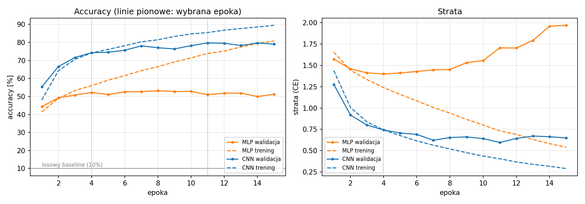
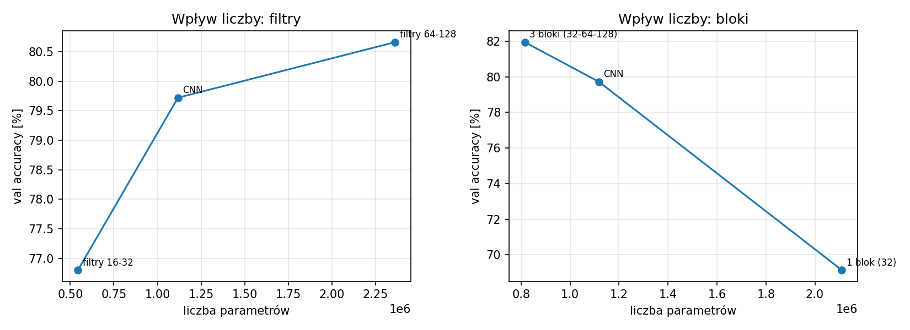
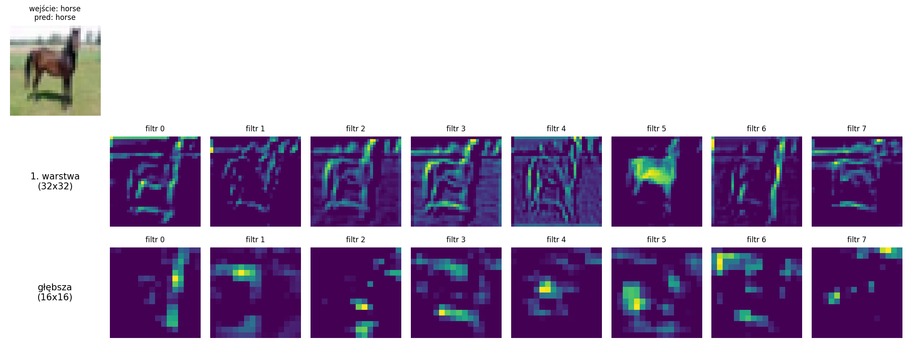

# Sprawozdanie laboratoryjne

**Przedmiot:** Uczenie głębokie do rozpoznawania obiektów
**Zajęcia nr 4 / temat:** CNN — splotowe sieci dla obrazów
**Autor / grupa:** Michał [UZUPEŁNIJ: nazwisko] / [UZUPEŁNIJ: grupa]
**Data:** [UZUPEŁNIJ]

Kod: [`lab4_cnn_vs_mlp.ipynb`](lab4_cnn_vs_mlp.ipynb) | Wyniki: `figures/`, `results/`

---

## 1. Cel ćwiczenia

Zbudowanie prostej sieci splotowej (CNN) i porównanie jej z perceptronem wielowarstwowym (MLP) na tym samym zbiorze CIFAR-10 pod względem accuracy, liczby parametrów i czasu uczenia, oraz zbadanie, jak lokalność i współdzielenie wag wpływają na różnice. Zakres dodatkowy: wpływ liczby filtrów i liczby bloków splotowych oraz wizualizacja map cech.

## 2. Metoda i implementacja

### 2.1 Dane

CIFAR-10: 60 000 kolorowych obrazów 32×32 w 10 klasach. Zbiór treningowy (50 000) podzielono **raz** na **45 000 treningowych i 5 000 walidacyjnych** (stała permutacja, seed 42, indeksy zapisane w `results/split_idx.npz`; klasy w walidacji są w przybliżeniu zbalansowane: 471–532 obrazy na klasę). Zbiór testowy (10 000) nie brał udziału w żadnych decyzjach. Przetwarzanie jest identyczne dla obu modeli: normalizacja kanałowa (średnia i odchylenie CIFAR-10), **bez augmentacji**. Wejście ma 3 kanały (MLP: 3·32·32 = 3072 wartości, CNN: `Conv2d(3, …)`).

### 2.2 Modele

| Model | Architektura | Parametry |
|---|---|---|
| MLP | `Flatten` (3072) → `Linear` 512 → `ReLU` → `Linear` 256 → `ReLU` → `Linear` 10 | 1 707 274 |
| CNN (baza) | 2 bloki [`Conv3×3` → `BatchNorm` → `ReLU`] × 2 → `MaxPool2` (kanały 32 i 64, 32×32 → 8×8), następnie `Flatten` (4096) → `Linear` 256 → `ReLU` → `Dropout(0,3)` → `Linear` 10 | 1 117 354 |

Rozkład parametrów: w MLP pierwsza warstwa gęsta ma 1 573 376 parametrów (92% modelu), w CNN część splotowa ma tylko ok. 66 tys. parametrów (6%), a pierwsza warstwa gęsta po spłaszczeniu 1 048 832 (94%).

### 2.3 Konfiguracja treningu i pomiaru

| Element | Wartość |
|---|---|
| Optymalizator | Adam, **lr = 1e-3** (oba modele) |
| Batch size | **128** |
| Budżet | **15 epok** (oba modele) |
| Funkcja straty | Cross-Entropy |
| Seed | 0 (inicjalizacja i kolejność batchy) |
| Wybór epoki | **najniższa strata walidacyjna** (checkpoint z tej epoki) |
| Sprzęt pomiaru czasu | **NVIDIA Tesla T4** (Google Colab), PyTorch 2.14.1+cu130 |
| Pomiar czasu | tylko pętla treningowa (bez ewaluacji), z synchronizacją GPU; dane w pamięci GPU, więc czas odzwierciedla obliczenia, a nie ładowanie danych |

**Uczciwość porównania:** te same dane i podział, to samo przetwarzanie, ten sam optymalizator, lr, batch i liczba epok oraz ta sama funkcja treningowa. Zbiór testowy użyto **jednokrotnie**, po wyborze checkpointów na walidacji; nie służył do żadnych decyzji.

## 3. Wyniki

### 3.1 Porównanie MLP i CNN

| Model | Parametry | Wybrana epoka | Accuracy walidacyjna [%] | **Accuracy testowa [%]** (checkpoint) | Accuracy testowa [%] (ostatnia epoka) | Nad losowym (10%) [p.p.] | Czas uczenia (15 epok) [s] | Czas / epokę [s] |
|---|---|---|---|---|---|---|---|---|
| MLP | 1 707 274 | 4 | 52,22 | **51,29** | 52,23 | +41,29 | 9,0 | 0,6 |
| CNN | 1 117 354 | 11 | 79,40 | **78,49** | 79,02 | +68,49 | 71,8 | 4,79 |

CNN uzyskała o **27,2 p.p.** wyższą accuracy testową (checkpoint) przy o 35% mniejszej liczbie parametrów, ale uczyła się ok. **8× dłużej** (71,8 s vs 9,0 s).

### 3.2 Krzywe uczenia

Linie ciągłe: walidacja, przerywane: trening (w trakcie epoki, tryb treningowy), pionowe linie: wybrana epoka. Szara linia poziomo to poziom losowy (10%).

### 3.3 Zakres dodatkowy: liczba filtrów i liczba bloków

| Eksperyment | Model | Parametry | Wybrana epoka | Accuracy walidacyjna [%] | Strata walidacyjna | Czas uczenia [s] |
|---|---|---|---|---|---|---|
| filtry | 16–32 | 543 962 | 11 | 77,02 | 0,671 | 30,2 |
| filtry | 32–64 (baza) | 1 117 354 | 11 | 79,40 | 0,631 | 71,8 |
| filtry | 64–128 | 2 360 906 | 8 | 79,36 | 0,593 | 158,1 |
| bloki | 1 blok (32) | 2 110 250 | 9 | 70,40 | 0,862 | 48,4 |
| bloki | 2 bloki (baza) | 1 117 354 | 11 | 79,40 | 0,631 | 71,8 |
| bloki | 3 bloki (32–64–128) | 815 018 | 7 | 80,52 | 0,564 | 83,4 |

*(porównanie na walidacji, zbiór testowy nie był używany)*

### 3.4 Zakres dodatkowy: mapy cech

Obraz walidacyjny: koń (klasa `horse`), sieć rozpoznała go poprawnie. Pokazano 8 pierwszych kanałów z pierwszej warstwy splotowej (po BatchNorm i ReLU, 32×32) oraz z drugiej warstwy splotowej drugiego bloku (16×16).

## 4. Analiza i interpretacja

**Jakość względem baseline'u.** CNN osiągnęła 78,49% accuracy testowej, a MLP 51,29%, czyli różnica wynosi 27,2 p.p. (CNN jest ok. 1,5× skuteczniejsza). Oba modele są wyraźnie powyżej poziomu losowego (10%): MLP o 41,3 p.p., CNN o 68,5 p.p. Błąd standardowy accuracy na 10 000 obrazach testowych to ok. 0,4–0,5 p.p., więc różnica jest wielokrotnie większa niż szum. Wynik z ostatniej epoki (MLP 52,23%, CNN 79,02%) prowadzi do tego samego wniosku; wybór checkpointu po stracie walidacyjnej dał wynik o 0,5–0,9 p.p. niższy niż ostatnia epoka, bo strata i accuracy nie osiągają optimum w tej samej epoce.

**Lokalność i współdzielenie wag.** W CNN ten sam mały filtr 3×3 przesuwa się po całym obrazie, więc (a) każdy neuron patrzy tylko na lokalne sąsiedztwo pikseli, a (b) wzorzec raz wyuczony (krawędź, kolor, tekstura) działa w każdym miejscu obrazu. MLP po `Flatten` traktuje każdy z 3072 pikseli jako niezależną cechę, nie zna sąsiedztwa i musi uczyć się rozpoznawać ten sam wzorzec osobno dla każdego położenia. Obiekty na CIFAR-10 pojawiają się w różnych miejscach i w różnej skali, więc MLP nie potrafi przenieść wiedzy między pozycjami i zamiast tego zapamiętuje zbiór treningowy. *Po chłopsku:* CNN uczy się „jednej lupy", którą przykłada wszędzie, a MLP uczy się osobnej lupy dla każdego miejsca. W wynikach widać to w przeuczeniu MLP (niżej) oraz w tym, że sieć o mniejszej liczbie parametrów jest dużo lepsza.

**Przeuczenie i wybór epoki.** MLP przeucza się szybko: strata treningowa spada (1,66 → 0,54), accuracy treningowa dochodzi do ok. 80%, a strata walidacyjna osiąga minimum już w epoce 4 (1,399) i rośnie do 1,97, przy accuracy walidacyjnej na poziomie 50–53%. Accuracy walidacyjna MLP ma maksimum w epoce 8 (53,18%), więc wybór epoki po stracie (epoka 4, 52,22%) nie jest tym samym co wybór po accuracy: strata rośnie, bo model staje się coraz pewniejszy także przy błędnych odpowiedziach, a liczba trafień zmienia się niewiele. CNN uczy się znacznie szybciej (55% po pierwszej epoce, 75% po czwartej) i przeucza się łagodniej: accuracy treningowa ok. 89–90% wobec 80% na walidacji, a strata walidacyjna po minimum (0,631 w epoce 11) waha się w zakresie 0,64–0,72 i wyraźnie nie rośnie. Accuracy walidacyjna CNN rosła jeszcze w ostatniej epoce (80,10%), więc dłuższy trening mógłby ją nieco poprawić.

**Liczba parametrów a koszt obliczeniowy.** CNN ma o ok. 35% mniej parametrów (1,12 mln vs 1,71 mln), a mimo to uczy się ok. 8× dłużej (4,79 s vs 0,6 s na epokę na Tesla T4). Liczba parametrów nie jest miarą kosztu: filtr jest stosowany w każdej pozycji obrazu, więc CNN wykonuje znacznie więcej operacji niż MLP o większej liczbie wag. MLP jest przy tym tak mały, że jego czas epoki prawdopodobnie zdominowany jest narzutem uruchamiania operacji na GPU (hipoteza, nie była testowana osobno). Koszt dodatkowych 63 s w zamian za +27 p.p. accuracy jest w tym zadaniu bardzo opłacalny. Warto zauważyć, że **94% parametrów CNN to pierwsza warstwa gęsta** (po spłaszczeniu 4096 wartości), a część splotowa ma tylko ok. 66 tys. parametrów, co dobrze pokazuje, jak tanie jest współdzielenie wag.

**Liczba filtrów (dodatkowo).** Zwiększenie z 16–32 do 32–64 filtrów podniosło accuracy walidacyjną o 2,4 p.p. (77,02% → 79,40%) i obniżyło stratę (0,671 → 0,631); dalsze podwojenie do 64–128 nie zmieniło accuracy (79,36%, różnica 0,04 p.p. jest daleko poniżej błędu standardowego ok. 0,6 p.p. na 5000 obrazach walidacyjnych), choć strata walidacyjna jest niższa (0,593). Kosztem są 2,1× więcej parametrów i 2,2× dłuższy trening (158 s vs 72 s). Zyski szybko się nasycają.

**Liczba bloków (dodatkowo).** Głębokość okazała się ważniejsza niż liczba parametrów. Model z **1 blokiem** ma najwięcej parametrów (2,11 mln, więcej niż MLP), a osiąga tylko 70,40% przy największej stracie walidacyjnej (0,862): po jednym poolingu spłaszcza 32×16×16 = 8192 wartości do dużej warstwy gęstej, a jego pola recepcyjne są małe. Model z **3 blokami** ma najmniej parametrów (0,82 mln), a najwyższą accuracy (80,52%) i najniższą stratę (0,564). Przewaga 3 bloków nad bazą (+1,1 p.p.) jest zbliżona do błędu pomiaru walidacji, więc jest sugestywna (spójna ze stratą), ale nie rozstrzygająca przy jednym seedzie. Czas treningu nie śledzi liczby parametrów (48 s, 72 s i 83 s dla 1, 2 i 3 bloków), bo o koszcie decydują rozdzielczość map i liczba filtrów, a nie liczba wag.

**Mapy cech (dodatkowo).** Pierwsza warstwa (pole recepcyjne 3×3 piksele) zachowuje pełną rozdzielczość i reaguje na proste wzorce: większość pokazanych filtrów wyraźnie podkreśla krawędzie i kontury konia (poziome, pionowe i ukośne), a filtr 5 wyróżnia całą sylwetkę zwierzęcia jako obszar o określonej barwie. Głębsza warstwa (16×16, pole recepcyjne ok. 14×14 pikseli) daje mapy rzadsze i bardziej „plamowe": aktywacje skupiają się w pojedynczych regionach i są dużo trudniejsze do zinterpretowania, co odpowiada reakcji na większe fragmenty obiektu, a nie na pojedyncze krawędzie. Jest to ilustracja na jednym obrazie i na pierwszych ośmiu kanałach, więc nie należy z niej wyciągać ogólnych wniosków.

**Ograniczenia.** Jeden seed i jeden przebieg pomiaru czasu (czas na współdzielonym GPU w Colabie może się wahać). Błąd standardowy accuracy wynosi ok. 0,4–0,5 p.p. na zbiorze testowym i ok. 0,6 p.p. na walidacyjnym, więc mniejsze różnice (np. między wariantami dodatkowymi) nie są wiarygodne. Budżet 15 epok, brak augmentacji i brak strojenia hiperparametrów. **Architektury różnią się nie tylko splotami:** CNN z ćwiczenia ma BatchNorm i dropout, a MLP nie, więc część różnicy może wynikać z regularyzacji, a nie wyłącznie ze struktury splotowej. Wyniki dotyczą CIFAR-10 i małych sieci; warianty dodatkowe oceniano tylko na walidacji, bez wyniku testowego.

## 5. Wnioski

1. Accuracy testowa: MLP **51,29%**, CNN **78,49%** (poziom losowy: 10%); CNN jest lepsza o **27,2 p.p.** przy o ok. 35% mniejszej liczbie parametrów (1 117 354 vs 1 707 274).
2. Czas uczenia (15 epok, Tesla T4): MLP 9,0 s, CNN 71,8 s, czyli CNN jest ok. 8× wolniejsza, mimo mniejszej liczby parametrów, bo filtr jest stosowany w każdej pozycji obrazu.
3. Przewaga CNN wynika z lokalności i współdzielenia wag (jeden filtr działa wszędzie), a MLP bez tej struktury przeucza się już od 4. epoki. Część różnicy może pochodzić z BatchNorm i dropoutu obecnych tylko w CNN.
4. Dodatkowo: 32–64 filtrów to dobry kompromis (16–32 jest o 2,4 p.p. gorsze, 64–128 nie poprawia accuracy kosztem 2,2× dłuższego treningu), a trzeci blok splotowy poprawił wynik (80,52% na walidacji) przy najmniejszej liczbie parametrów, natomiast model z jednym blokiem jest wyraźnie gorszy (70,40%).
5. Kierunki poprawy: augmentacja i dłuższy trening, strojenie hiperparametrów, kilka seedów, porównanie MLP z tą samą regularyzacją (BatchNorm, dropout) oraz głębsze sieci splotowe.

*[OPCJONALNIE, jeśli prowadzący tego wymagają: Użycie narzędzi AI: do przygotowania szkieletu kodu i struktury sprawozdania wykorzystano asystenta AI (Claude, Anthropic); eksperymenty, analizę i wnioski wykonano samodzielnie.]*
