# Sprawozdanie laboratoryjne

**Przedmiot:** Uczenie głębokie do rozpoznawania obiektów
**Zajęcia nr 5 / temat:** Warstwy splotowe: operacja, parametry, interpretacja
**Autor / grupa:** Michał [UZUPEŁNIJ: nazwisko] / [UZUPEŁNIJ: grupa]
**Data:** [UZUPEŁNIJ]

Kod: [`lab5_warstwy_splotowe.ipynb`](lab5_warstwy_splotowe.ipynb) | Wyniki: `figures/`, `results/`

---

## 1. Cel ćwiczenia

Zbadanie działania warstwy splotowej na zdjęciu w skali szarości: ręczne jądra (`F.conv2d`), wzór na wymiary wyjścia i jego sprawdzenie w `nn.Conv2d`, wpływ `stride`, `padding` i `dilation`, interpretacja map cech pretrenowanego ResNet-18 oraz porównanie filtrów rozmywających (Box 3×3, Box 5×5, Gaussian 5×5). Zakres dodatkowy: własne jądro ukośne, porównanie filtrów pierwszej i głębszej warstwy oraz liczba parametrów `Conv2d` vs warstwa gęsta.

## 2. Metoda i implementacja

### 2.1 Zdjęcie

Wszystkie punkty wykonano na **jednym zdjęciu** w skali szarości przedstawiającym papugę (nimfę), innym niż zdjęcie demonstracyjne z ćwiczenia. **Źródło i warunki użycia:** [UZUPEŁNIJ: skąd pochodzi zdjęcie (autor, link, licencja) albo że jest własne]. Zdjęcie ma rozmiar 512×512 px (zmniejszenie do dłuższego boku 512 px nie było potrzebne), wartości jasności mieszczą się w przedziale 0,035–0,831. Na zdjęciu nie ma osób.

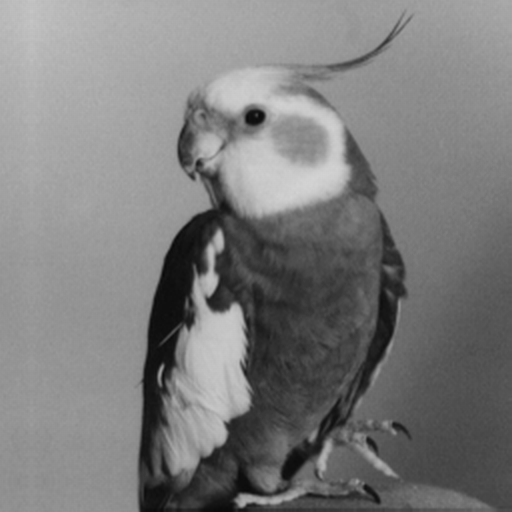

Do porównania rozmyć wybrano jeden fragment 96×96 px, **automatycznie** jako okno o największej średniej sile krawędzi. Leży w dolnej części zdjęcia, przy łapie ptaka (czerwona ramka):

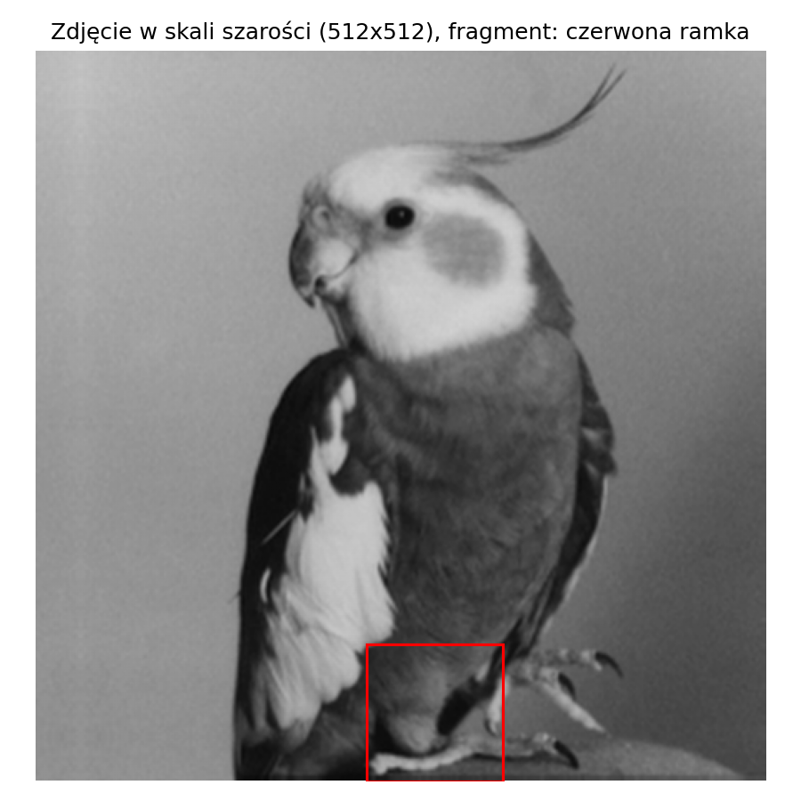

### 2.2 Narzędzia i jądra

PyTorch (`F.conv2d`, `nn.Conv2d`), torchvision (ResNet-18 z wagami ImageNet), matplotlib, pandas. Wagi jąder zgodnie ze wstępem teoretycznym; sumy wag zweryfikowano w kodzie:

| Jądro | Rozmiar | Wagi | Suma wag |
|---|---|---|---|
| Sobel X | 3×3 | `[[-1,0,1],[-2,0,2],[-1,0,1]]` | 0 |
| Sobel Y | 3×3 | transpozycja Sobela X | 0 |
| Laplacian (8 sąsiadów) | 3×3 | środek +8, wszystkie otaczające −1 | 0 |
| Sharpen | 3×3 | środek +5, sąsiedzi w pionie i poziomie −1, reszta 0 | 1 |
| Box 3×3 | 3×3 | każda waga 1/9 | 1 |
| Box 5×5 | 5×5 | każda waga 1/25 | 1 |
| Gaussian 5×5 | 5×5 | iloczyn zewnętrzny `[1,4,6,4,1]` z samym sobą, podzielony przez 256 | 1 |

## 3. Wyniki

### 3.1 Ręczne jądra

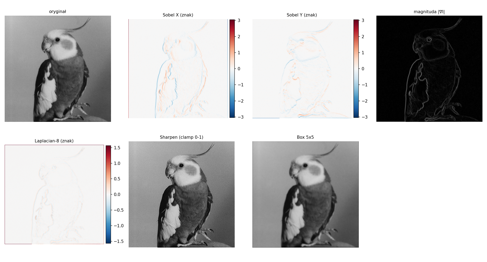

Mapy ze znakiem (Sobel, Laplacian) pokazano paletą rozbieżną wyśrodkowaną w zerze (czerwony: dodatnia odpowiedź, niebieski: ujemna).

| Jądro | Co robi | Obserwacja na zdjęciu |
|---|---|---|
| Sobel X | porównuje prawą kolumnę okna z lewą, silnie reaguje na **pionowe** krawędzie; znak mówi, czy jasność rośnie w prawo (+), czy maleje (−) | najsilniejsze odpowiedzi leżą na pionowych konturach ciała i skrzydła; po przeciwnych stronach tej samej struktury pojawiają się przeciwne znaki (niebieskie i czerwone linie), bo jasność raz maleje, a raz rośnie w prawo |
| Sobel Y | porównuje dolny wiersz z górnym, reaguje na **poziome** krawędzie | odpowiedzi słabsze i rzadsze; widoczne m.in. na poziomych fragmentach upierzenia, wokół oka i przy dolnej krawędzi (podpórka) |
| Magnituda \|∇I\| = √(gx² + gy²) | siła zmiany jasności niezależnie od kierunku | czysty zarys papugi: kontur ciała, głowa z czubkiem, oko, skrzydło i pazury, jednolite tło pozostaje czarne |
| Laplacian | przybliża drugą pochodną; suma wag 0, więc na jednolitym obszarze odpowiedź jest zerowa; reaguje na zmiany w każdej orientacji | bardzo słabe, cienkie odpowiedzi wzdłuż konturów (skala ±1,5 wobec ±3 dla Sobela) |
| Sharpen | zwiększa lokalny kontrast przy krawędzi (suma wag 1 zachowuje jasność obszarów jednolitych); wynik obcięto do [0, 1] | wyraźniejsze kontury i upierzenie, ale też wzmocnione ziarno na tle |
| Box 5×5 | lokalna średnia, wygładza drobne detale | obraz wyraźnie bardziej miękki, drobna tekstura upierzenia zanika |

Na brzegach map Sobela i Laplace'a widać cienkie linie wzdłuż krawędzi obrazu: to artefakt dopełnienia zerami (sztuczna krawędź między obrazem a zerami), omówiony w 3.3.

### 3.2 Wymiary wyjścia: wzór i `nn.Conv2d`

Wzór (osobno dla wysokości i szerokości): `out = ⌊(in + 2p − d(k−1) − 1) / s⌋ + 1`, efektywny rozmiar okna `k_eff = 1 + d(k−1)`.

| Wejście (H×W) | k | s | p | d | k_eff | Wzór | Wynik `nn.Conv2d` | Zgodne |
|---|---|---|---|---|---|---|---|---|
| 32×32 | 3 | 1 | 1 | 1 | 3 | 32×32 | 32×32 | tak |
| 32×32 | 3 | 2 | 1 | 1 | 3 | 16×16 | 16×16 | tak |
| 32×32 | 5 | 1 | 2 | 1 | 5 | 32×32 | 32×32 | tak |
| 32×32 | 3 | 1 | 2 | 2 | 5 | 32×32 | 32×32 | tak |
| 32×32 | 7 | 2 | 3 | 1 | 7 | 16×16 | 16×16 | tak |
| 8×8 | 3 | 2 | 0 | 1 | 3 | 3×3 (zaokrąglenie w dół) | 3×3 | tak |
| 6×7 | 3 | 2 | 1 | 2 | 5 | 2×3 (osie osobno) | 2×3 | tak |

### 3.3 Wpływ `stride`, `padding` i `dilation`

Ten sam detektor (Sobel X, moduł odpowiedzi) na zdjęciu 512×512; zmieniany jest **jeden parametr naraz** względem bazy (s = 1, p = 1, d = 1). Wszystkie rozmiary zgodne ze wzorem.

| Wariant | Rozmiar wyjścia | Efekt |
|---|---|---|
| baza (s=1, p=1, d=1) | 512×512 | rozmiar zachowany (2p = d(k−1)) |
| stride = 2 | 256×256 | co drugie położenie okna, 4× mniej wartości; obraz podobny, ale na rzadszej siatce |
| padding = 0 | 510×510 | mapa mniejsza o 2 px w każdej osi (okna nie wychodzą poza obraz), brak ramki na brzegach |
| padding = 3 | 516×516 | mapa większa o 4 px; na lewym i prawym brzegu widoczne jasne pionowe linie (sztuczna krawędź ze strefą zer) |
| dilation = 2 (p = 1) | 510×510 | okno 5×5 przy 9 wagach, ale p = 1 nie wystarcza (2p = 2 < d(k−1) = 4), więc mapa mniejsza o 2 px |
| dilation = 2 (p = 2) | 512×512 | rozmiar zachowany (2p = d(k−1) = 4) |

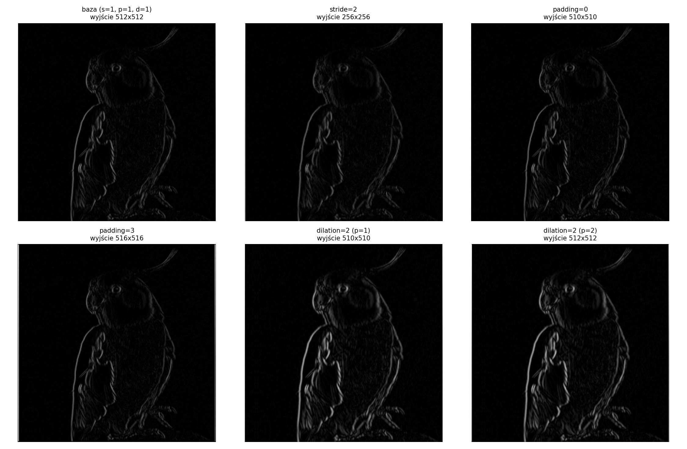

Warianty z `dilation = 2` dają jaśniejsze i szersze odpowiedzi: zdjęcie ma miękkie krawędzie, więc szersze okno (5 px przy tych samych 9 wagach) widzi większą różnicę jasności.

Dopełnienie zerami a powielenie brzegu (jasny, jednolity obraz 8×12, Sobel X):

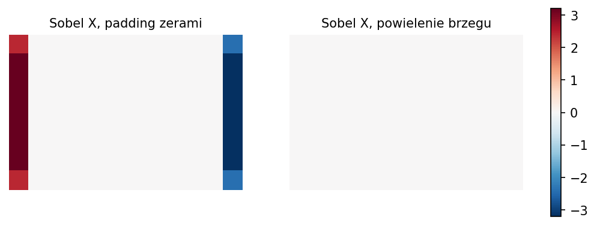

Przy dopełnieniu zerami Sobel X reaguje na lewym i prawym brzegu (+3,2 i −3,2, bo (1+2+1)·0,8 = 3,2; w narożnikach 2,4, bo okno ma mniej pikseli), mimo że obraz jest jednolity. Powielenie brzegu daje zerową odpowiedź na całej mapie. Geometria wyjścia jest w obu przypadkach taka sama, różnią się wartości przy brzegu.

### 3.4 Mapy cech pretrenowanego ResNet-18

Zdjęcie w skali szarości podano jako trzy identyczne kanały, z preprocessingiem modelu (zmniejszenie do 256, kadr środkowy 224×224, normalizacja ImageNet). Pokazano 8 kanałów o największej średniej aktywności dla `conv1` (po ReLU), `layer1` i `layer3`:

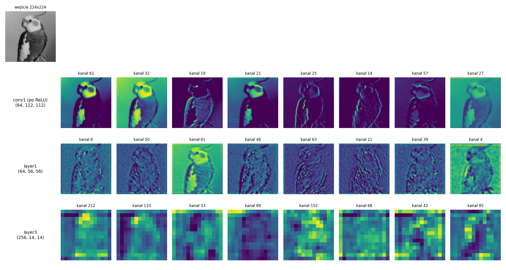

Kształty: `conv1` → 64×112×112, `layer1` → 64×56×56, `layer3` → 256×14×14. Wagi `conv1`: 64 filtry 7×7×3.

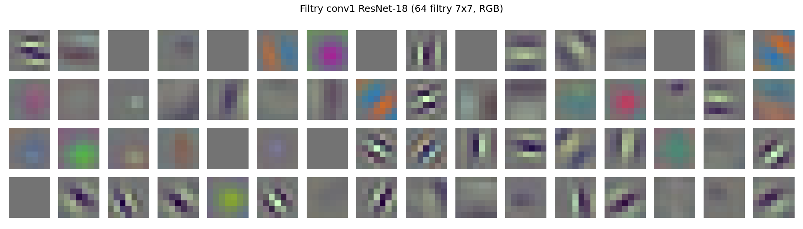

- **`conv1` (112×112).** Dwa rodzaje kanałów: kanały 61, 32, 21 i 27 przypominają wygładzony obraz wejściowy (reagują na jasność i duże plamy, np. białą głowę i pierś), a kanały 19, 25, 14 i 57 to mapy krawędzi, na których widać kontur ciała, skrzydło, głowę i pazury o różnych orientacjach.
- **`layer1` (56×56).** Kanał 61 nadal przypomina obraz, ale większość kanałów (8, 50, 46, 63, 11, 39) pokazuje drobniejszą, tekstury podobną strukturę (upierzenie) o niskim kontraście.
- **`layer3` (14×14).** Mapy są grube i plamiste, sylwetka ptaka przestaje być rozpoznawalna; aktywności skupiają się w pojedynczych miejscach (np. kanały 212 i 110 mają maksimum w górnej środkowej części mapy, co może odpowiadać okolicy głowy, ale przy tej rozdzielczości nie da się tego jednoznacznie stwierdzić).
- **Filtry `conv1`.** Wiele filtrów to detektory krawędzi o różnych orientacjach (pionowe, poziome, ukośne pasy jasno-ciemne), część to plamy kolorów (fioletowa, zielona, niebiesko-pomarańczowa), a część jest prawie płaska. Na obrazie w skali szarości trzy kanały są identyczne, więc filtr kolorowy sprowadza się do sumy wag kanałów R, G i B i nie wykrywa koloru.

### 3.5 Porównanie filtrów rozmywających

Box 3×3, Box 5×5 i Gaussian 5×5 (`stride = 1`, `dilation = 1`, `padding = k // 2`, rozmiar zachowany). Filtrowano całe zdjęcie i dopiero potem wycięto ten sam fragment; wspólna skala jasności 0–1.

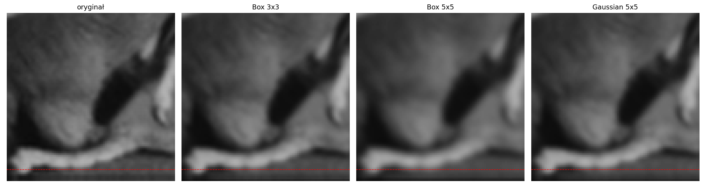

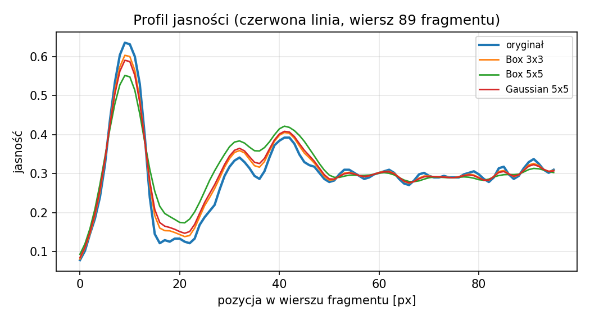

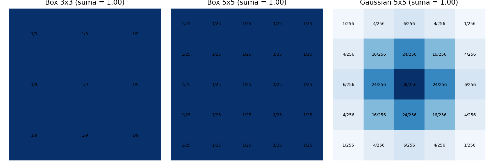

| Wariant | Średnia magnituda gradientu | Maks. magnituda gradientu | Odchylenie std jasności |
|---|---|---|---|
| oryginał | 0,2209 | 1,3522 | 0,1431 |
| Box 3×3 | 0,2056 (−6,9%) | 1,1381 (−15,8%) | 0,1401 |
| Box 5×5 | 0,1859 (−15,8%) | 0,8707 (−35,6%) | 0,1346 |
| Gaussian 5×5 | 0,1996 (−9,6%) | 1,0773 (−20,3%) | 0,1385 |

**Box 3×3 vs Box 5×5.** Box 5×5 rozmywa wyraźnie mocniej. Na fragmencie ciemny, ukośny pazur ma po Box 3×3 jeszcze dość wyraźne brzegi, a po Box 5×5 przejście do sąsiedniego szarego upierzenia jest szersze i bardziej rozmyte, a drobna tekstura w lewym górnym rogu praktycznie znika. Profil jasności to potwierdza (odczyt z wykresu): jasny szczyt przy lewej krawędzi (ok. 0,635 w oryginale) spada do ok. 0,60 po Box 3×3 i do ok. 0,55 po Box 5×5, a dolina obok niego rośnie z ok. 0,12 do ok. 0,15 i ok. 0,19, więc różnica szczyt–dolina maleje o ok. 12% (Box 3×3) i ok. 30% (Box 5×5). Maksymalna magnituda gradientu spada o 15,8% i 35,6%. Mniejsze oscylacje drobnego detalu (prawa część profilu, ok. 0,28–0,33) są po Box 5×5 niemal spłaszczone. Większe jądro uśrednia 25 zamiast 9 pikseli, więc silniej wygładza i usuwa detale o rozmiarze kilku pikseli.

**Box 5×5 vs Gaussian 5×5.** Mimo tego samego rozmiaru okna Gaussian rozmywa wyraźnie słabiej niż Box 5×5: zachowuje ostrzejszy kontur pazura i wyższy szczyt w profilu (ok. 0,59 wobec ok. 0,55), a jego wskaźniki leżą między Boxem 3×3 a Boxem 5×5 (maks. gradient −20,3% wobec −15,8% i −35,6%). Wynika to z rozkładu wag: Box daje każdemu z 25 pikseli jednakowy udział (1/25 = 4%), a Gaussian największą wagę nadaje środkowi (36/256 ≈ 14%) i zmniejsza ją z odległością (narożniki 1/256 ≈ 0,4%). W środkowym oknie 3×3 Gaussiana mieści się 196/256 ≈ 77% sumy wag (w Boxie 5×5 tylko 9/25 = 36%), więc działa on bardziej jak lokalna średnia z najbliższego sąsiedztwa i mniej psuje krawędzie.

### 3.6 Zakres dodatkowy

**Własne jądro: krawędzie ukośne.** Dwa jądra typu Sobel obrócone o 45°: A `[[0,1,2],[-1,0,1],[-2,-1,0]]` (dodatnie wagi w prawym górnym rogu) i B `[[2,1,0],[1,0,-1],[0,-1,-2]]` (dodatnie wagi w lewym górnym rogu).

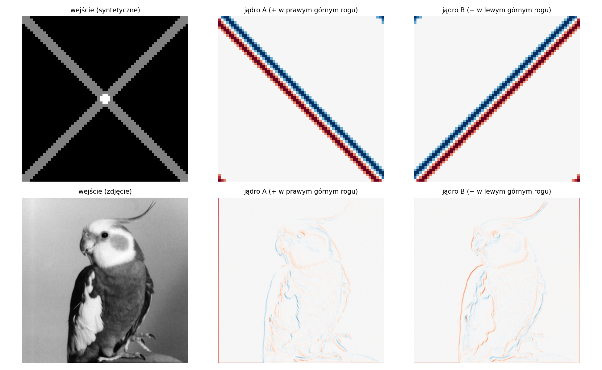

Na obrazie syntetycznym (dwie przecinające się ukośne linie) jądro A reaguje wyłącznie na linię `\` (biegnącą od lewego górnego do prawego dolnego rogu), a jądro B wyłącznie na linię `/`; po obu stronach linii odpowiedzi mają przeciwne znaki (jasność rośnie, potem maleje), a w narożnikach obrazu widać artefakty dopełnienia zerami. Na zdjęciu jądro B wyraźniej wydobywa ukośny kontur lewej strony ciała (biegnący jak `/`), a jądro A wyróżnia krawędzie o przeciwnej orientacji.

**Filtry pierwszej i głębszej warstwy.**

![Filtry layer1[0].conv1 (3×3, średnia po kanałach)](figures/resnet_layer1_weights.png)

Filtry `conv1` są obrazkami RGB, które można odczytać jak detektory krawędzi i plam koloru (3.4). Filtry `layer1[0].conv1` działają na mapy cech (64 kanały wejściowe), a nie na kolory; po uśrednieniu po kanałach wejściowych wyglądają jak wzorce typu środek–otoczenie lub kierunkowe gradienty 3×3, ale są tylko podglądem (uśrednienie gubi informację o poszczególnych kanałach), więc nie da się ich interpretować wprost jak obrazów.

**Liczba parametrów: `Conv2d` vs warstwa gęsta o tym samym wejściu i wyjściu.** `Conv2d`: C_out·C_in·k·k + C_out (bez biasu: bez ostatniego składnika); `Linear`: in·out + out, gdzie in = C_in·H·W, out = C_out·H'·W'.

| Warstwa | Wejście → wyjście | Parametry `Conv2d` | Parametry `Linear` | Stosunek |
|---|---|---|---|---|
| Conv2d(3, 8, 3, p=1) | 3×32×32 → 8×32×32 | 224 | 25 174 016 | 112 384× |
| Conv2d(64, 64, 3, p=1) (`layer1`) | 64×56×56 → 64×56×56 | 36 928 | 40 282 296 320 | 1 090 833× |
| Conv2d(3, 64, 7, s=2, p=3, bez biasu) (`conv1`) | 3×224×224 → 64×112×112 | 9 408 | 120 847 089 664 | 12 845 141× |

## 4. Analiza i interpretacja

**Trzy pytania kontrolne.**
- *Które wagi jądra sprawiają, że filtr reaguje na wybrany wzorzec?* O wzorcu decyduje układ i znaki wag. Sobel X ma ujemną lewą i dodatnią prawą kolumnę (różnica jasności prawa − lewa), więc reaguje na pionowe krawędzie; sumy wag równe 0 (Sobel, Laplacian) dają zerową odpowiedź na obszarach jednolitych, a sumy równe 1 (Box, Gaussian, Sharpen) zachowują jasność. Jądra ukośne A i B (dodatnie wagi w jednym rogu, ujemne w przeciwległym) reagują na linie o jednej, wybranej orientacji ukośnej.
- *Ile map cech powstanie dla jednego obrazu?* Tyle, ile filtrów (`out_channels`): 1 dla jądra ręcznego `[1,1,k,k]`, 8 dla `Conv2d(3, 8, …)`, 64 dla `conv1` ResNet-18 (tensor [1, 64, 112, 112]).
- *Ile pełnych położeń okna mieści się w każdej osi?* Tyle, ile daje wzór `out = ⌊(in + 2p − d(k−1) − 1)/s⌋ + 1` (tabela 3.2), liczone osobno dla wysokości i szerokości; np. dla 512 px, k = 3, s = 2, p = 1, d = 1 jest ich 256.

- **Jądra ręczne.** Sobel X i Y wydobywają krawędzie o przeciwnych orientacjach, a magnituda łączy je w czysty zarys ptaka na jednolitym tle (Sobel X silniejszy, bo zdjęcie ma przede wszystkim pionowe kontury). Laplacian jest bardziej wrażliwy na szum i daje słabsze, cieńsze odpowiedzi. Sharpen wzmacnia kontrast przy krawędziach, ale też ziarno, a Box 5×5 usuwa drobne detale.
- **Wymiary.** Wzór zgodził się z `nn.Conv2d` we wszystkich 7 przypadkach, także dla zaokrąglenia w dół (wejście 8×8, k = 3, s = 2, p = 0 → 3×3) i dla niekwadratowego wejścia 6×7 (→ 2×3) z dylatacją.
- **Stride, padding, dilation.** `stride` zmniejsza rozdzielczość mapy (rzadsza siatka odpowiedzi), `padding` decyduje o rozmiarze i odpowiedzi na brzegu (zera tworzą sztuczną krawędź, czego nie robi powielenie brzegu), a `dilation` zwiększa zasięg okna bez zwiększania liczby wag, ale wymaga większego dopełnienia (2p = d(k−1)), żeby zachować rozmiar.
- **Mapy cech ResNet-18.** Wczesne kanały odpowiadają prostym cechom: jasności i krawędziom o różnych orientacjach. W głębszych warstwach rozdzielczość maleje (112 → 56 → 14), mapy robią się plamiste, a sylwetka przestaje być rozpoznawalna, co jest zgodne z tym, że głębsze warstwy kodują większe i bardziej abstrakcyjne fragmenty obrazu. Pokazano 8 kanałów o największej średniej aktywności, więc obraz jest wybiórczy. Filtry kolorowe nie miały czego wykrywać, bo wejście było w skali szarości.
- **Rozmycia.** Większe jądro (Box 5×5 vs Box 3×3) rozmywa mocniej, a rozkład wag ma znaczenie: Gaussian 5×5 zachowuje ostrzejsze krawędzie niż Box 5×5, bo ok. 77% jego wag leży w centralnym oknie 3×3.
- **Parametry.** Współdzielenie wag powoduje, że `Conv2d` ma o 5–7 rzędów wielkości mniej parametrów niż warstwa gęsta o tym samym wejściu i wyjściu; liczba parametrów `Conv2d` nie zależy od rozmiaru obrazu, tylko od C_in, C_out i k.
- **Ograniczenia.** Jedno zdjęcie o niskim kontraście (jasność 0,035–0,831) i miękkich krawędziach, więc obserwacje dotyczą jego treści. Fragment do porównania rozmyć wybrano automatycznie według siły krawędzi, więc jest z założenia bogaty w krawędzie i nie jest reprezentatywny dla całego zdjęcia. Profil jasności dotyczy jednego wiersza, a jego wartości odczytano z wykresu (przybliżone). Mapy cech ResNet-18 pokazano dla 8 wybranych kanałów, a interpretacja wizualna jest subiektywna. Metryki rozmycia (magnituda gradientu, odchylenie std) są przybliżoną miarą ostrości.

## 5. Wnioski

1. Wzór na wymiary wyjścia zgadza się z `nn.Conv2d` we wszystkich 7 przypadkach, także z zaokrągleniem w dół i dla wejścia niekwadratowego.
2. Ręczne jądra realizują proste operacje: Sobel wykrywa krawędzie o określonej orientacji (X: pionowe, Y: poziome), Laplacian zmiany w każdej orientacji, Sharpen zwiększa kontrast (kosztem wzmocnienia ziarna), Box i Gaussian wygładzają.
3. `stride` zmniejsza mapę (512 → 256), `padding` kontroluje rozmiar (510 / 512 / 516) i zachowanie na brzegu (zera dają sztuczną krawędź), a `dilation` zwiększa zasięg okna bez dodatkowych wag, ale wymaga p = d(k−1)/2, żeby zachować rozmiar.
4. W ResNet-18 wczesne kanały `conv1` reagują na jasność i krawędzie, a w głębszych warstwach mapy stają się coraz grubsze i bardziej abstrakcyjne.
5. Box 5×5 rozmywa mocniej niż Box 3×3 (spadek maksymalnej magnitudy gradientu o 35,6% wobec 15,8%), a Gaussian 5×5 rozmywa słabiej niż Box 5×5 (−20,3%) dzięki wagom skupionym przy środku okna.
6. Warstwa splotowa ma wielokrotnie mniej parametrów niż gęsta o tym samym wejściu i wyjściu (np. `conv1` ResNet-18: 9 408 wobec ok. 1,2·10¹¹).

*[OPCJONALNIE, jeśli prowadzący tego wymagają: Użycie narzędzi AI: do przygotowania szkieletu kodu i struktury sprawozdania wykorzystano asystenta AI (Claude, Anthropic); eksperymenty, analizę i wnioski wykonano samodzielnie.]*
