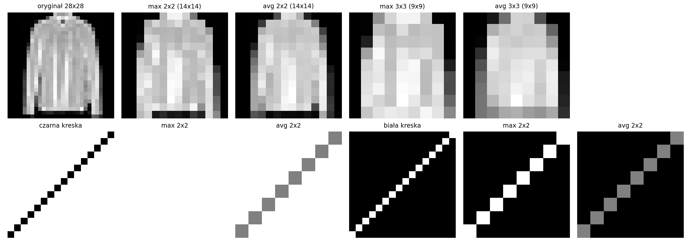
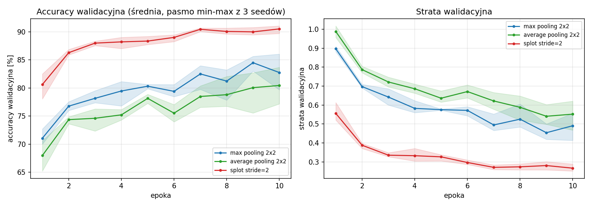
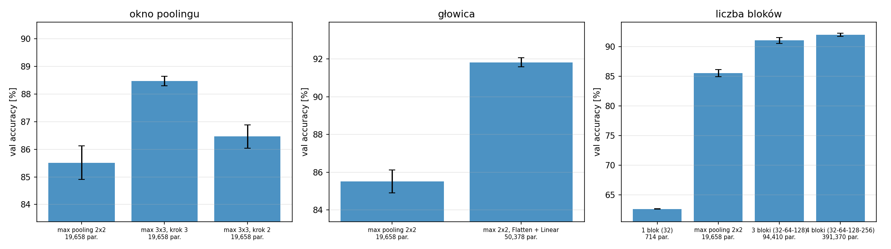

# Sprawozdanie laboratoryjne

**Przedmiot:** Uczenie głębokie do rozpoznawania obiektów
**Zajęcia nr 6 / temat:** Warstwa łącząca (pooling) i pełna CNN
**Autor / grupa:** Michał [UZUPEŁNIJ: nazwisko] / [UZUPEŁNIJ: grupa]
**Data:** [UZUPEŁNIJ]

Kod: [`lab6_pooling_cnn.ipynb`](lab6_pooling_cnn.ipynb) | Wyniki: `figures/`, `results/`

---

## 1. Cel ćwiczenia

Zbudowanie pełnej CNN (bloki splot–BatchNorm–ReLU–redukcja i głowica GAP → Linear) i zbadanie, jak sposób redukcji wymiaru przestrzennego wpływa na jakość, liczbę parametrów i rozmiar mapy cech przed głowicą. Porównano trzy warianty: max pooling, average pooling i splot z krokiem 2, na zbiorze FashionMNIST. Zakres dodatkowy: rozmiar okna poolingu (2×2 vs 3×3), głowica GAP vs spłaszczenie oraz liczba bloków.

## 2. Metoda i implementacja

### 2.1 Dane

FashionMNIST (obrazy 28×28 w skali szarości, 10 klas odzieży). Zbiór treningowy (60 000) podzielono **raz** na **50 000 treningowych i 10 000 walidacyjnych** (stała permutacja, seed 42, indeksy w `results/split_idx.npz`); oficjalny zbiór testowy (10 000) nie brał udziału w żadnych decyzjach. Przetwarzanie: normalizacja (średnia 0,2860, odchylenie 0,3530), bez augmentacji. Wybrano ten sam zbiór co w ćwiczeniu, żeby porównanie było spójne z materiałami zajęć.

### 2.2 Architektura

Blok: `Conv3×3 (padding 1)` → `BatchNorm` → `ReLU` → **redukcja**, gdzie redukcją jest `MaxPool2d(2)`, `AvgPool2d(2)` albo dodatkowy `Conv3×3 (stride 2, padding 1)` → `BatchNorm` → `ReLU`. Dwa bloki (32 i 64 kanały), głowica `AdaptiveAvgPool2d(1)` → `Flatten` → `Linear(64, 10)`.

| Etap | Kształt dla paczki |
|---|---|
| Wejście | [N, 1, 28, 28] |
| Po pierwszym bloku | [N, 32, 14, 14] |
| Po drugim bloku (przed głowicą) | [N, 64, 7, 7] |
| Po GAP i spłaszczeniu | [N, 64] |
| Logity | [N, 10] |

### 2.3 Konfiguracja treningu

| Element | Wartość |
|---|---|
| Optymalizator | Adam, lr = 1e-3 (wszystkie warianty) |
| Batch size | 128 |
| Budżet | **10 epok** (wszystkie warianty) |
| Seedy | 0, 1, 2 (każdy wariant trenowany 3 razy; podajemy średnią ± odchylenie standardowe) |
| Wybór epoki i modelu | **najniższa strata walidacyjna** (osobno dla każdego przebiegu) |
| Zbiór testowy | użyty **jednokrotnie**, po zamrożeniu wyboru checkpointów, tylko dla wariantów głównych |
| Sprzęt | NVIDIA Tesla T4 (Google Colab), PyTorch 2.14.1+cu130 |
| Pomiar czasu | tylko pętla treningowa (bez ewaluacji), z synchronizacją GPU; dane w pamięci GPU |

**Uczciwość porównania:** te same dane i podział, ten sam optymalizator, lr, batch i liczba epok oraz ta sama funkcja treningowa i inicjalizacja (te same seedy). W odróżnieniu od notebooka z ćwiczenia (który raportuje najwyższą accuracy testową z przebiegu, czyli wybiera po zbiorze testowym) wybór robimy na walidacji, a test służy tylko do końcowej oceny. Trzy seedy dają oszacowanie szumu, bo różnice między wariantami mogą być małe.

## 3. Wyniki

### 3.1 Mechanika poolingu

Na macierzy 4×4 ze wstępu max pooling 2×2 daje `[[6, 8], [14, 16]]`, average pooling `[[4, 5], [11,5, 13,5]]`, a GAP jedną wartość 8,5 (kształt wyjścia [1, 1, 1, 1]). Rozmiar wyjścia liczymy wzorem `out = ⌊(L − k) / s⌋ + 1`; wzór zgadza się z `MaxPool2d` we wszystkich 7 przypadkach:

| Wejście L | Okno k | Krok s | Wzór | `MaxPool2d` |
|---|---|---|---|---|
| 28 | 2 | 2 | 14 | 14 |
| 14 | 2 | 2 | 7 | 7 |
| 7 | 2 | 2 | 3 | 3 |
| 28 | 3 | 3 | 9 | 9 |
| 9 | 3 | 3 | 3 | 3 |
| 28 | 3 | 2 | 13 | 13 |
| 13 | 3 | 2 | 6 | 6 |

- **Obraz (sweter z FashionMNIST).** Max pooling zachowuje jasne pasy i kontrasty, więc obraz po redukcji jest jaśniejszy i bardziej „kontrastowy", a average pooling go wygładza i uśrednia. Okno 3×3 daje mapę 9×9 (28 = 9·3 + 1, więc ostatni wiersz i kolumna wypadają poza okna) i wyraźnie bardziej blokowy obraz.
- **Cienka kreska.** Czarna kreska na białym tle **znika** po max poolingu 2×2 (każde okno zawiera biały piksel), a average pooling pokazuje ją jako szary pas. Biała kreska na czarnym tle zostaje po max poolingu jako biała, a po average poolingu jest szara (połowa jasności).

### 3.2 Porównanie trzech wariantów redukcji

| Wariant | Parametry | Mapa przed głowicą | Accuracy walidacyjna [%] | **Accuracy testowa [%]** | Wybrane epoki | Czas uczenia [s] |
|---|---|---|---|---|---|---|
| max pooling 2×2 | 19 658 | 64×7×7 | 85,51 ± 0,61 | **85,00 ± 0,62** | 10, 9, 9 | 14,6 |
| average pooling 2×2 | 19 658 | 64×7×7 | 82,78 ± 0,88 | **82,43 ± 1,01** | 10, 9, 9 | 14,8 |
| splot stride = 2 | 66 026 | 64×7×7 | 90,80 ± 0,22 | **89,81 ± 0,34** | 7, 10, 8 | 22,4 |

*(średnia ± odchylenie standardowe z 3 seedów; źródło: `results/main_comparison.csv`, wyniki poszczególnych przebiegów: `results/per_run_main.csv`)*

Poziom losowy dla 10 klas to 10%, więc wszystkie warianty są o 72–80 p.p. powyżej niego.

Liczba parametrów: max i average pooling mają po 19 658 parametrów, bo obie operacje redukcji nie mają uczonych wag; wariant ze splotem z krokiem 2 ma **o 46 368 więcej** (dwa dodatkowe sploty 3×3: 32·32·9 + 32 = 9 248 i 64·64·9 + 64 = 36 928 oraz dwie warstwy BatchNorm: 64 i 128), czyli 66 026, ok. 3,4× więcej. We wszystkich wariantach mapa przed głowicą ma ten sam rozmiar 64×7×7, bo splot 3×3 z krokiem 2 i dopełnieniem 1 daje ⌊(28 + 2 − 3)/2⌋ + 1 = 14, a potem 7.

W każdym seedzie max pooling był lepszy od average poolingu (accuracy testowa: 85,41 / 85,31 / 84,29 wobec 83,59 / 81,81 / 81,89), a splot z krokiem lepszy od obu (89,44 / 90,10 / 89,88).

### 3.3 Krzywe accuracy

Linie: średnia z 3 seedów, pasmo: minimum–maksimum.

### 3.4 Zakres dodatkowy

Wszystkie warianty dodatkowe ocenione na walidacji (3 seedy, 10 epok); bazą jest max pooling 2×2 z GAP.

| Eksperyment | Wariant | Parametry | Mapa przed głowicą | Accuracy walidacyjna [%] | Wybrane epoki | Czas uczenia [s] |
|---|---|---|---|---|---|---|
| okno poolingu | 2×2, krok 2 (baza) | 19 658 | 64×7×7 | 85,51 ± 0,61 | 10, 9, 9 | 14,6 |
| okno poolingu | 3×3, krok 3 | 19 658 | 64×3×3 | 88,47 ± 0,18 | 10, 9, 9 | 11,3 |
| okno poolingu | 3×3, krok 2 (nakładające się okna) | 19 658 | 64×6×6 | 86,46 ± 0,42 | 10, 9, 9 | 14,6 |
| głowica | GAP → Linear (baza) | 19 658 | 64×7×7 | 85,51 ± 0,61 | 10, 9, 9 | 14,6 |
| głowica | Flatten → Linear (3136 cech) | 50 378 | 64×7×7 | 91,83 ± 0,24 | 9, 7, 6 | 15,0 |
| liczba bloków | 1 blok (32) | 714 | 32×14×14 | 62,63 ± 0,06 | 10, 10, 10 | 8,1 |
| liczba bloków | 2 bloki (baza) | 19 658 | 64×7×7 | 85,51 ± 0,61 | 10, 9, 9 | 14,6 |
| liczba bloków | 3 bloki (32–64–128) | 94 410 | 128×3×3 | 91,02 ± 0,51 | 6, 9, 8 | 19,5 |
| liczba bloków | 4 bloki (32–64–128–256) | 391 370 | 256×1×1 | 91,99 ± 0,28 | 5, 3, 4 | 23,1 |

*(źródło: `results/extras.csv`)*

Głowica: GAP → Linear ma 64·10 + 10 = 650 parametrów, a Flatten → Linear 3136·10 + 10 = 31 370 (różnica 30 720 parametrów, w całym modelu 19 658 vs 50 378).

Pole recepcyjne komórki mapy przed głowicą (obliczone ręcznie z parametrów warstw: dla każdej warstwy RF += (k − 1)·skok, skok *= s):

| Wariant | Pole recepcyjne [px] | Accuracy walidacyjna [%] |
|---|---|---|
| 1 blok, max 2×2 | 4 | 62,63 |
| 2 bloki, max 2×2 (baza) | 10 | 85,51 |
| 2 bloki, max 3×3 krok 2 | 13 | 86,46 |
| 2 bloki, max 3×3 krok 3 | 17 | 88,47 |
| 3 bloki, max 2×2 | 22 | 91,02 |
| 4 bloki, max 2×2 | 46 (cały obraz 28×28) | 91,99 |
| 2 bloki, splot stride 2 (4 warstwy splotowe) | 13 | 90,80 |

## 4. Analiza i interpretacja

**Pytanie kontrolne: jaką informację zachowują maksimum z okna, średnia z okna i średnia z całego kanału?**
- *Maksimum z okna* zachowuje najsilniejszą odpowiedź w oknie (czy cecha tam wystąpiła), a gubi dokładną pozycję w oknie i słabsze wartości; pojedyncza duża wartość może zdominować wynik.
- *Średnia z okna* zachowuje średni poziom aktywacji w oknie, więc wygładza wahania i uwzględnia udział jasnych i ciemnych pikseli, ale może osłabić rzadką, użyteczną odpowiedź.
- *Średnia z całego kanału (GAP)* daje jedną liczbę na kanał: „jak mocno cecha występuje w całym obrazie", a całkowicie usuwa układ przestrzenny w obrębie kanału (dwie mapy o tej samej średniej dają tę samą wartość, nawet gdy aktywne obszary leżą w różnych miejscach).

**Jakość wariantów.** Najlepszy jest splot z krokiem 2 (89,81% na teście), potem max pooling (85,00%), a najgorszy average pooling (82,43%). Różnice są większe niż odchylenia standardowe z 3 seedów (0,2–1,0 p.p.) i utrzymują się w każdym seedzie (najgorszy seed splotu z krokiem, 89,44%, jest lepszy od najlepszego seeda max poolingu, 85,41%), więc wiarygodnie wskazują kolejność wariantów w tym ustawieniu. Wszystkie trzy modele są daleko powyżej poziomu losowego (10%). Accuracy testowa jest o 0,4–1,0 p.p. niższa od walidacyjnej, co jest typowe, gdy wybór epoki dokonuje się na walidacji.

**Kompromis jakość / parametry.** Splot z krokiem 2 daje +4,8 p.p. accuracy testowej względem max poolingu, kosztem 3,4× więcej parametrów (66 026 vs 19 658) i ok. 53% dłuższego treningu (22,4 s vs 14,6 s). Pooling nie dodaje uczonych parametrów, a splot z krokiem jest uczoną redukcją: sam wybiera, jak łączyć pozycje okna. **Nie wolno jednak przypisać całej różnicy samej operacji redukcji:** wariant ze splotem ma też dwa razy więcej warstw splotowych (4 zamiast 2), więc jest głębszy i ma większą pojemność. Wskazuje na to eksperyment z blokami: sieć z 3 blokami i zwykłym max poolingiem (94 410 parametrów) osiąga 91,02% na walidacji, tyle co wariant ze splotem z krokiem (90,80%), a 4 bloki 91,99%. Przy tej samej liczbie parametrów lepiej wypada też tańsza zmiana: max pooling 3×3 z krokiem 3 (te same 19 658 parametrów) poprawia wynik o 3,0 p.p. i trenuje się szybciej. Rozdzielenie wpływu głębokości od wpływu samej operacji wymagałoby osobnego eksperymentu (np. max pooling z dodatkowym splotem bez kroku).

**Max vs average.** Max pooling jest lepszy od average o 2,7 p.p. na walidacji i 2,6 p.p. na teście, w każdym seedzie. Zgadza się to z mechaniką z 3.1: max zachowuje najsilniejsze odpowiedzi (krawędzie, kontury, tekstury), a average je rozcieńcza z tłem, co w klasyfikacji odzieży, gdzie ważne są wyraziste cechy, może osłabiać użyteczny sygnał. To interpretacja zgodna z wynikami, nie testowana osobno.

**Krzywe.** Splot z krokiem uczy się najszybciej i najstabilniej: accuracy walidacyjna rośnie z ok. 81% w pierwszej epoce do ok. 90,5%, strata walidacyjna spada z ok. 0,55 do ok. 0,27, a pasmo między seedami jest wąskie. Max i average pooling mają szerokie pasma (do kilku p.p.), accuracy w kolejnych epokach waha się, a ich najlepsze epoki to 9–10, czyli przy końcu budżetu: strata walidacyjna nadal maleje, więc budżet 10 epok jest dla tych wariantów za krótki, a ranking mógłby się zmienić przy dłuższym treningu.

**Okno poolingu (dodatkowo).** Większe okno poprawiło wynik: 3×3 z krokiem 3 (mapa 64×3×3) osiąga 88,47% wobec 85,51% dla 2×2 (+3,0 p.p., we wszystkich seedach), a 3×3 z krokiem 2 (nakładające się okna, mapa 64×6×6) 86,46% (+0,95 p.p.). Parametrów nie przybywa (GAP zależy tylko od liczby kanałów), a okno 3×3 z krokiem 3 trenuje się szybciej (11,3 s), bo drugi blok liczy się na mapie 9×9 zamiast 14×14. Wyniki układają się zgodnie z polem recepcyjnym komórki mapy przed GAP (10, 13 i 17 px, tabela w 3.4). Wyjaśnienie (hipoteza, nietestowana przyczynowo): GAP usuwa układ przestrzenny, a płytka sieć z oknem 2×2 widzi przez każdą komórkę tylko fragment 10×10 pikseli, więc większe pole recepcyjne daje bogatsze cechy. Należy uważać na zbyt agresywną redukcję: okno 3×3 z krokiem 3 gubi ostatni wiersz i kolumnę obrazu (28 = 9·3 + 1).

**GAP vs spłaszczenie (dodatkowo).** Spłaszczenie dało największy zysk w eksperymentach dodatkowych: 91,83% wobec 85,51% (+6,3 p.p.) przy 2,6× większej liczbie parametrów (50 378 vs 19 658; sama głowica 31 370 vs 650). W tej płytkiej sieci GAP jest więc wąskim gardłem, bo zrzuca informację o położeniu aktywacji; spłaszczenie ją zachowuje, a model uczy się też szybciej (najlepsze epoki 9, 7, 6). Korzyści GAP (mała liczba parametrów, niezależność od rozmiaru wejścia) mają w tym ustawieniu wyraźny koszt w jakości. Jeśli liczy się wyłącznie accuracy przy małym koszcie, spłaszczenie (+30 720 parametrów, +6,3 p.p.) jest tu korzystniejsze niż splot z krokiem (+46 368 parametrów, +5,3 p.p. na walidacji).

**Liczba bloków (dodatkowo).** Każda redukcja 2×2 zmniejsza wysokość i szerokość o połowę (z zaokrągleniem w dół): 28 → 14 → 7 → 3 → 1, więc 4 bloki dają mapę 1×1 (GAP jest wtedy zbędny). Accuracy rośnie z liczbą bloków, ale z malejącymi przyrostami: 62,63% (1 blok) → 85,51% (2) → 91,02% (3) → 91,99% (4), czyli +22,9, +5,5 i +1,0 p.p. Jeden blok (714 parametrów, mapa 32×14×14, pole recepcyjne 4 px) jest wyraźnie za słaby. Głębsze modele osiągają najlepszą epokę wcześniej (3–5 dla 4 bloków) i kosztują więcej czasu (23,1 s) oraz parametrów (391 370, ok. 20× więcej niż baza przy +6,5 p.p.). Większość parametrów dodają kolejne kanały (32 → 256), a nie sama liczba bloków.

**Ograniczenia.**
- Trzy seedy dają tylko przybliżone oszacowanie szumu, a odchylenia standardowe z 3 wartości są niedokładne.
- Budżet 10 epok jest za krótki dla płytszych wariantów (najlepsze epoki 9–10), więc wyniki dotyczą tego budżetu, a nie zbieżności.
- Nie strojono hiperparametrów osobno dla wariantów.
- Wariant ze splotem z krokiem różni się od poolingu nie tylko operacją, ale też liczbą warstw splotowych i parametrów, więc nie izoluje wpływu samej redukcji.
- Pola recepcyjne policzono ręcznie, a ich związek z wynikami to hipoteza zgodna z danymi, nie dowód przyczynowy.
- Warianty dodatkowe oceniano wyłącznie na walidacji, bez wyniku testowego, a konfigurację wybierano spośród wielu na tym samym zbiorze walidacyjnym, co lekko zawyża wyniki.
- FashionMNIST jest prostym zbiorem, a wnioski mogą nie przenosić się na trudniejsze zbiory (np. CIFAR-10). Czas mierzono na współdzielonym GPU w Colabie (średnia z 3 przebiegów).

## 5. Wnioski

1. Pełna CNN (2 bloki, GAP → Linear) osiąga na teście 89,81% ze splotem z krokiem 2, 85,00% z max poolingiem i 82,43% z average poolingiem (poziom losowy: 10%); we wszystkich wariantach mapa przed głowicą ma rozmiar 64×7×7.
2. Parametry: max i average pooling 19 658 (redukcja bez uczonych wag), splot z krokiem 2 66 026 (+46 368, ok. 3,4×); czas uczenia 14,6 s, 14,8 s i 22,4 s (Tesla T4).
3. Kolejność wariantów jest stabilna we wszystkich seedach: splot z krokiem > max > average. Przewaga splotu z krokiem (+4,8 p.p. na teście) idzie w parze z większą głębokością (4 warstwy splotowe) i 3,4× większą liczbą parametrów, więc nie wynika wyłącznie z samej operacji redukcji; podobny wynik daje 3 bloki z max poolingiem (91,02% na walidacji).
4. Eksperymenty dodatkowe: większe okno poolingu (3×3, krok 3) daje +3,0 p.p. bez parametrów, spłaszczenie zamiast GAP +6,3 p.p. (za +30 720 parametrów), a kolejne bloki dają malejące przyrosty (62,6% → 85,5% → 91,0% → 92,0%).
5. Kierunki poprawy: dłuższy trening, więcej seedów, porównanie wariantów przy wyrównanej głębokości i liczbie parametrów, trudniejszy zbiór (CIFAR-10).

*[OPCJONALNIE, jeśli prowadzący tego wymagają: Użycie narzędzi AI: do przygotowania szkieletu kodu i struktury sprawozdania wykorzystano asystenta AI (Claude, Anthropic); eksperymenty, analizę i wnioski wykonano samodzielnie.]*
